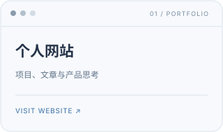
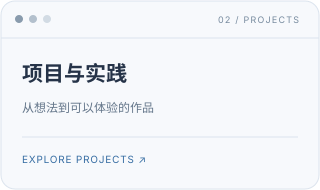
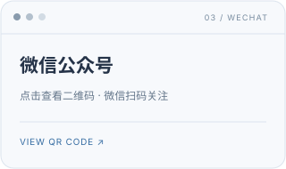

# 马超越

**AI 产品经理** · 产品研究 / Agent 工作流 / 交互体验

从用户需求出发，关注 AI 能力如何融入真实场景。 通过产品研究、原型和实践，探索更有价值的体验。

  

---

## 项目与作品

| 项目 | 内容 |
| :--- | :--- |
| **[拾要 · 文章精读](https://github.com/ma1282097762-yy/article-essence-studio)** | 文章精读页面与可复用 Skill，支持浏览器本地提炼和 Markdown 导出。 |
| **[懂车帝 3D 展示](https://github.com/ma1282097762-yy/dongchedi-3d-showcase)** | 结合 3D 车型、灯光与场景的交互式汽车展示概念网站。 |
| **[个人网站](https://github.com/ma1282097762-yy/ma1282097762-yy.github.io)** | 记录项目、文章和个人介绍的网页空间。 |

[查看全部公开仓库的最近更新 →](https://github.com/ma1282097762-yy?tab=repositories&sort=updated)

## Skill & Workflow

| 项目 | 内容 |
| :--- | :--- |
| **[AI 产品拆解 Skill](https://github.com/ma1282097762-yy/ai-product-teardown)** | 以分端体验、五层分析和实测取证的方式研究 AI 产品。 |
| **[文章精读 Skill](https://github.com/ma1282097762-yy/article-essence-studio)** | 将文章内容整理为结构化精读稿，作为拾要项目的一部分。 |

## 关于我

我是马超越，一名 AI 产品经理。 
我关注 AI 产品如何理解用户需求、设计交互流程，并在真实场景中发挥作用。 
平时通过产品拆解、Agent 工作流和原型实践，探索从想法到体验的过程。

### 我的关注

- **产品研究**：从用户旅程和实际体验出发，观察 AI 产品如何解决问题。
- **Agent 工作流**：探索任务拆解、工具协作与可复用 Skill 的设计。
- **体验与原型**：用网页与交互原型表达产品想法，验证和迭代体验。
- **内容与学习**：整理文章与产品观察，让思考成为可复用的知识。

**关注方向**　`AI 产品研究` `产品拆解` `Agent Skills` `文章精读` `交互体验` `3D 展示`

**项目中使用与探索**　`HTML` `CSS` `JavaScript` `Three.js` `GitHub Pages`

---

[个人网站](https://ma1282097762-yy.github.io/) · [GitHub](https://github.com/ma1282097762-yy)
